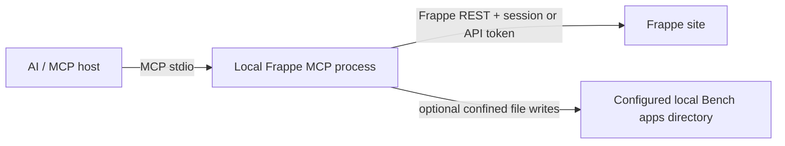

# Architecture

## Request flow

The MCP server runs as an independent Python process launched by the MCP host. It does not register a Frappe method, run inside a Bench worker, or require an app installation on the target site. The site is accessed through standard `/api/resource/...` and `/api/method/...` endpoints.

## Package layout

| Path | Responsibility |
|---|---|
| `frappe_mcp/standalone.py` | MCP stdio entry point, HTTP authentication, tools, bounded inputs, and optional local exports |
| `legacy/` | Previous Frappe app and transport source retained for reference; excluded from the installable package |
| `e2e/` | Standalone acceptance runners/evidence and the historical report from the old hosted implementation |
| `docs/` | User, agent, security, and compatibility documentation |

## Authentication and permissions

The process supports Frappe API token authentication or the standard login endpoint. HTTP password login is accepted only for loopback or `.localhost`; other hosts require HTTPS. Credentials are read at process start and are never stored in the repository. Every API operation is made as that Frappe user, so native permissions and validation remain authoritative.

## Customization and exports

Create tools use standard REST resources such as `DocType`, `Custom Field`, and `Property Setter`. Standard DocType creation passes native field definitions, settings, and permissions through Frappe's DocType controller; in developer mode, Frappe performs schema setup and generates the JSON and controller scaffolds. Role permission changes use Frappe's System Manager-only Permission Manager methods. The user must have the corresponding Frappe permissions. The local export tools additionally require `FRAPPE_APPS_PATH` and verify that the requested Module Def belongs to the selected app on the remote site. Resolved module paths must remain below the configured directory.

`export_form_customizations` previews the current customization source state and expected `custom/<doctype>.json` paths, then calls Frappe's whitelisted `frappe.modules.utils.export_customizations` method. Frappe itself generates the file on its host, with `sync_on_migrate` true by default; the source DocType may belong to another app. Frappe provides no dry-run for this method, so the preview is not a content diff. When the app tree is shared with the MCP, changed files receive backups and a rollback manifest; `rollback_export` restores/removes files only if they have not changed since. When paths are not shared, the MCP cannot inspect or roll back the host files. Fixture export remains a Bench operation (`bench export-fixtures`) and is not emulated by the standalone MCP because no corresponding public HTTP method exists. Review generated code and use normal Git review and Bench migration/deployment procedures. The MCP does not run migrations or deploy changes.

## Limits

The generic server can discover and operate on custom app DocTypes through Frappe APIs, but it cannot transparently invoke every app-specific whitelisted method. A method needs an explicit tool wrapper and must be safe to expose. Arbitrary method dispatch, SQL, and Python execution are intentionally absent. See the roadmap and tool reference for supported operations.
