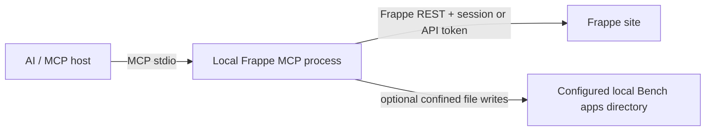

# Architecture

## Request flow

The MCP server runs as an independent Python process launched by the MCP host. It does not register a Frappe method, run inside a Bench worker, or require an app installation on the target site. The site is accessed through standard `/api/resource/...` and `/api/method/...` endpoints.

## Package layout

| Path | Responsibility |
|---|---|
| `frappe_mcp/__init__.py` | `__version__`, the only version source (`pyproject.toml` reads it through hatch's dynamic version) |
| `frappe_mcp/standalone.py` | `mcp-frappe` command line (`main()`), MCP stdio server, HTTP authentication, tools, bounded inputs, and optional local exports |
| `legacy/` | Previous Frappe app and transport source retained for reference; excluded from the installable package |
| `e2e/` | Live-site acceptance runners over MCP stdio; `e2e/history/` holds earlier reports and evidence, including the old hosted implementation's |
| `docs/` | User, agent, security, and compatibility documentation |

## Command line

`main(argv)` parses the arguments with `argparse`. With no command it validates the startup settings (`_startup_settings()`: timeout, metadata TTL, site label, toolsets), removes the unselected toolsets, and runs `server.run(transport="stdio")`. In that mode stdout carries only MCP messages; the insecure-HTTP warning, the remote read-only notice (`_remote_mode_notice()`), and other logs go to stderr through `logging`, and a bad setting exits through `SystemExit` with a one-line message on stderr. `--version` prints `mcp-frappe <__version__>`. `check` runs `_setup_check()`: the same settings checks, then `get_site_info()` for the login, versions, and `FRAPPE_APPS_PATH` (plus a writability check of each found app package), printed as one status row per step. It prints `FRAPPE_URL` as `scheme://host[:port]` only, and `_redact()` replaces any configured key, secret, or password of eight or more characters in the output, in case an error message echoes one.

## Tools, toolsets, and errors

Tools register through `_tool(toolset, title, destructive=..., idempotent=..., read_only=...)`, which records the tool in `_TOOLSETS` (`read`, `data`, `customize`, `developer`) and passes a `title` and `ToolAnnotations` to `server.tool()`; the `read` toolset sets `readOnlyHint`, and `read_only=True` sets it for a tool in another toolset. It registers a `functools.wraps` wrapper (FastMCP reads the signature through `__wrapped__`) that turns an `httpx.TransportError` escaping the tool into a `RuntimeError` from `_unreachable_message()`: the site as `scheme://host[:port]`, the kind of failure, and "run `mcp-frappe check`". The module-level function is returned unwrapped, so the reload helpers and other callers still see the raw `httpx.TransportError`. The HTTP client connects with `min(FRAPPE_TIMEOUT, 5)` seconds and reads with the full timeout. At startup, `main()` reads `FRAPPE_MCP_TOOLSETS` and `FRAPPE_MCP_READ_ONLY` through `_selected_toolsets()` (a remote target, per `_remote_target()`, gets only `read` unless `FRAPPE_MCP_READ_ONLY=NO`) and `_apply_toolsets()` calls `server.remove_tool()` for every tool outside the selection, so the host never lists it. `FastMCP("frappe", instructions=_INSTRUCTIONS)` sends the agent workflow in the initialize result. Arguments shared by many tools are typed with `Annotated[..., Field(description=...)]` aliases (`Filters`, `Fields`, `OrderBy`, `ExpectedModified`, `ExpectedPreview`, `Confirm`, `Detail`, ...), so their descriptions reach each tool's input schema. `_tool()` passes the docstring through `inspect.cleandoc` (Python before 3.13 keeps its indentation), registers with `structured_output=False` (no output schema; Frappe returns open-ended JSON), and runs `_trim_schema()` on the generated input schema: it drops pydantic's `title` keywords, `additionalProperties: true`, `items: {}`, and the `null` branch of optional arguments. The annotations carry no `title`, since the tool's own `title` is the display name. `_tool_list_cost()` measures each toolset as a client receives it, for `check`; `tests/test_mcp_contract.py` caps the whole list at 40,000 characters (32,000 in stage 15, raised in stages 16, 19, and 20). After a write tool returns, the wrapper also journals the call when it was confirmed (`confirm=True`), unless the tool is in `_SELF_JOURNALED` (see [change journal](#change-journal)).

`_check()` turns an error response (or an `exc` inside a 200 response) into `FrappeError` through `_frappe_error()`: it decodes the two JSON levels of `_server_messages`, strips HTML, appends a hint from `_ERROR_HINTS` for the exception class, and caps the text at `_ERROR_MAX_CHARS`. The error keeps `status`, `exc_type`, and `message`; Frappe's traceback is dropped. Callers branch on `exc_type`, never on the message text.

## Authentication and permissions

The process supports Frappe API token authentication or the standard login endpoint. Both auth modes require HTTPS for hosts other than loopback or `.localhost`, unless `FRAPPE_ALLOW_INSECURE_HTTP=YES` is set for a trusted development network. A password session is created only after a successful login; when it expires, `_request()` confirms the expiry with `frappe.auth.get_logged_user`, logs in again, and retries the request once. Credentials are read at process start and are never stored in the repository. Every API operation is made as that Frappe user, so native permissions and validation remain authoritative.

## Metadata

DocType metadata comes from `GET /api/method/frappe.desk.form.load.getdoctype`, the call Desk makes to open a form. Frappe answers with `frappe.get_meta` for the DocType and for each of its Table / Table MultiSelect DocTypes; `Meta` has already added Custom Fields, applied Property Setters, and sorted fields (`field_order`, then `insert_after`). `_meta_bundle()` turns that into `{"doctype": meta, "children": {name: meta}}`, drops the form assets (`__js`, print formats, templates), and caches it per process for `FRAPPE_META_TTL` seconds (default 300, `0` for no cache). The schema tools that change metadata drop the affected entries; a `delete_document` of a Custom Field, Property Setter, or Custom DocPerm (the only schema records the record tools still write) clears the whole cache.

The bundle also carries `workflow`, the name of the DocType's active Workflow, taken from the `__workflow_docs` that `FormMeta.load_workflows` adds. `submit_document` and `cancel_document` drop the cached entry first and read it fresh, since they refuse DocTypes with an active Workflow.

`getdoctype` needs only a logged-in user, so field validation in the record tools no longer depends on reading the `DocType`, `Custom Field`, and `Property Setter` resources, which only System Manager can list. Record tools therefore work for any user with permission on the DocType, and Frappe still checks that permission on every record request. A filtered `list_documents` makes two requests with a cold cache (metadata, then the list) and one with a warm cache. List tools ask for `limit + 1` rows and return `limit`, so `has_more` costs no extra request.

## Customization and exports

Create tools use standard REST resources such as `DocType`, `Custom Field`, and `Property Setter`. Standard DocType creation passes native field definitions, settings, and permissions through Frappe's DocType controller; in developer mode, Frappe performs schema setup and generates the JSON and controller scaffolds. Role permission changes use Frappe's System Manager-only Permission Manager methods. The user must have the corresponding Frappe permissions. Custom Fields and Property Setters need no local checkout; an optional `module` (and `app`) is checked only against the remote Module Def. The local export tools additionally require `FRAPPE_APPS_PATH` and verify that the requested Module Def belongs to the selected app on the remote site. Resolved module paths must remain below the configured directory.

Exports preview changes and return a `preview_id`. Confirmation must provide the current ID. `export_customizations` writes the same file as Frappe's own `frappe.modules.utils.export_customizations` (Customize Form's "Export Customizations"): `<app>/<app>/<module>/custom/<scrubbed doctype>.json`, holding `custom_fields`, `property_setters`, `custom_perms`, `links`, `doctype`, and `sync_on_migrate`, one file per DocType and per child-table DocType it uses. It builds the file from REST reads on the MCP side, so it needs no developer mode on the site and keeps the preview, backups, and rollback. `bench migrate` imports these files through `sync_customizations` when `sync_on_migrate` is set. Client Scripts are not part of that file; they go to the app-level `<app>/<app>/fixtures/client_script.json`, which `bench migrate` imports through `import_fixtures`, and a managed block in `hooks.py` registers the matching fixture filter while preserving surrounding content. DocType JSON is never exported: in developer mode Frappe writes standard DocType files itself. Existing files receive backups and an export manifest. `rollback_export` previews and restores/removes those files only if the exported contents have not changed since. Review exported code and use normal Git review and Bench migration/deployment procedures. The MCP does not run migrations or deploy changes.

## Editing DocTypes and reload reconciliation

`update_doctype` reads the DocType record (`GET /api/resource/DocType/<name>`, which keeps each field row's `name`), applies the operation list to a copy, and sends one `PUT` with the full `fields` list, the changed settings, and the preview's `modified`. Frappe's `update_child_table` updates rows whose `name` it knows, inserts rows without one, and deletes rows left out, so untouched fields keep their identity. Before saving, the tool checks Link and Table targets against the site's DocType list, counts affected records with `frappe.client.get_count`, and reads the DocType's meta to keep new fieldnames clear of Custom Fields.

Saving a standard DocType in developer mode makes Frappe's `on_update` export the JSON (`export_to_files`) and possibly rewrite the controller's type annotations. A Bench running with the reloader may restart the web worker and cut the response off. On `httpx.TransportError` the tool calls `_wait_for_server_ready`, re-reads the DocType, and reports success only if `modified` moved and the saved field order, the properties the operations set, and the DocType settings match the plan. Otherwise it fails and asks for a fresh preview; it never resends the save. `delete_doctype` uses the same pattern with `_wait_for_document_deleted`, since deleting a standard DocType in developer mode removes its folder, Python files included.

## Site and app sync

`diff_doctype` and `list_app_drift` compare the site's DocType records with the app checkout under `FRAPPE_APPS_PATH`. `_app_root()` and `_module_dir()` hold the path checks `_app_path()` uses for writes, without the writability check; `_app_file()` resolves each file strictly and refuses one that escapes its module folder. `_normalize_doctype()` reduces a DocType record and its exported JSON to the keys both hold (Frappe's `export_doc` drops blanks, system columns, and child-row names, and keeps the field order in `field_order`), and `_compare_doctypes()` diffs them in `update_doctype`'s shape; moved fields are those outside the longest common field order. `_doctype_file_drift()` picks the verdict from `modified` and the site's `migration_hash`: Frappe v16.33.1's `import_file_by_path` re-imports a DocType JSON whenever its MD5 differs from that hash (or none is stored), even when the site is newer, then stores the hash. Other document types are skipped when the database `modified` is at least the file's. Customization files are compared row by row; `sync_customizations` applies every file row on migrate (when `sync_on_migrate` is set) and never deletes site rows.

The developer diagnostics are read tools too. `list_pending_patches` reads `patches.txt` through `_app_root()`/`_app_file()`, parses it in `_parse_patches()` the way Frappe's `patch_handler` does (INI sections when a header comes first, otherwise one patch per line; the whole line is the patch, `finally:` is dropped for the comparison), and pages through every `Patch Log` row in `_patch_log()` (`_PATCH_LOG_PAGE` per request, at most `_PATCH_LOG_MAX`). `get_recent_errors` reads `Error Log` with a filter list built from its arguments and trims each traceback in `_error_row()`. `list_app_methods` walks the package with `os.walk` (not following symlinked folders), resolves each `.py` file and refuses one outside the app, caps files and bytes (`_METHOD_MAX_FILES`, `_METHOD_FILE_MAX_BYTES`), and parses files that mention `whitelist` with `ast.parse`; `_file_methods()` tracks how `frappe` and `whitelist` were imported and `_whitelist_call()` reads the decorator's keywords with `ast.literal_eval`. Nothing from the app is imported or executed.

Allowlisted method calls are opt-in. `main()` calls `_method_settings()` after the other startup settings: when `FRAPPE_MCP_METHODS` is set, `_load_method_config()` reads the file (at most 1 MB and 200 entries), checks each entry (`_config_entry()`, `_config_param()`, the `_METHOD_PATH` pattern, `_DISPATCH_METHODS`/`_DISPATCH_PREFIXES`), and finds each method in the app checkout with `_method_source()`, which parses one module file with the `list_app_methods` scanner (`_file_methods()`); `_source_problem()` compares the decorator's HTTP methods and the arguments with the entry. Problems are collected with the line of each entry (`_config_line()`) and stop startup. The entries go to `_method_config`, and `_register_method_tools()` registers `list_allowed_methods`, `make_mapped_document`, and `call_allowed_method` in the `data` toolset before `_apply_toolsets()` runs, so the toolset rules apply to them; `_tool(..., read_only=True)` marks the two that save nothing. Without the variable the tools are never registered, so the default tool list and its budget don't include them. Calls go through `_allowed_entry()` (the method must be listed with a fitting kind), `_method_call_args()`, and `_request()`; `_bounded_result()` pages and caps results, and `_mapped_draft()` splits a returned document into `create_document` values and read-only fields using `_meta_bundle()` of the target DocType.
Bench commands are opt-in too. `main()` calls `_bench_settings()` after `_method_settings()`: when `FRAPPE_BENCH_PATH` is set, `_load_bench_config()` refuses a non-local `FRAPPE_URL`, resolves the folder, checks the site name (`FRAPPE_BENCH_SITE` or `FRAPPE_SITE`, `_SAFE_NAME`, and `sites/<site>/site_config.json` when the folder has `sites/`), parses `FRAPPE_BENCH_COMMAND` (`_bench_command()`, found with `shutil.which`) and `FRAPPE_BENCH_TIMEOUT`, and stores the result in `_bench_config`; `_register_bench_tool()` registers `run_bench` in the `bench` toolset before `_apply_toolsets()`. `run_bench` builds the argv in `_bench_argv_tail()` (one branch per command, each checking its own arguments against the site and the checkout), reads the preflight with `_bench_state()` (`list_app_drift`, `list_pending_patches`, `_fixture_files()`; a failing part becomes `unavailable`), and hashes command, site, argv, warning, and preflight into the `preview_id`. On confirmation it recomputes everything, compares the id, and calls `subprocess.run` with a list argv, `cwd` the Bench folder, `stdin` closed, `_bench_env()` (an allowlist of variables), and the timeout. `_bench_output()` strips terminal codes, replaces the Bench folder and configured secrets, and keeps the tail; `_test_summary()` reads unittest's `Ran N tests` and `OK`/`FAILED` lines. Afterwards it waits with `_wait_for_server_ready()`, clears the metadata cache, and reads `_bench_state()` again, also after a failure or timeout.

`promote_custom_doctype` uses Frappe's own export: a DocType saved with `custom=0` in developer mode, outside an import, runs `export_doc` and `make_controller_template` in `on_update`, which skips files that already exist. Like `create_doctype`, it writes the controller templates first and waits for the Bench to settle, so the save itself only writes JSON, then reconciles a reload by re-reading the DocType.

## Configuration records

Workflows, Notifications, Reports, and Workspaces are saved through `_save_config_record()`. It creates the record with a `POST` (the record name in the body; Notification's autoname is Prompt, which keeps it) or updates it with a `PUT` carrying the preview's `modified`, maps `TimestampMismatchError` to the stale-preview error, and clears the metadata cache for the record's DocType and any DocType the save changes. Saving an enabled standard Notification in developer mode makes Frappe's `on_update` call `export_module_json` and write the message file, which can reload a Bench; on `httpx.TransportError` the helper waits with `_wait_for_server_ready`, re-reads the record, and succeeds only if it holds the sent values (child rows compared in order) and, on update, `modified` moved.

`upsert_workflow` follows Frappe v16.33.1's `Workflow` controller: `validate` runs `set_active` (deactivates the DocType's other Workflows when this one is active) and `validate_docstatus`; `on_update` adds the state field as a hidden Link Custom Field when the DocType lacks it and sets the state of records that have none to the first state with their docstatus. The tool checks the same rules first and shows those effects in the preview. Existing child rows are matched (states by `state`, transitions by state, action, and role) and sent with their `name` and unmanaged columns, because `Document.update_child_table` saves a row sent without a column with that column's default. The Workflow State and Workflow Action Master records are created before the Workflow. `upsert_notification` follows `Notification.validate`: the event's own fields, the child-table rule, `validate_template`, and `validate_standard` (an enabled standard Notification needs developer mode).

Notification templates are checked by `_assert_template()` before anything is sent (see [security](security.md#code-fields-and-templates)). Workflows have no module, so `export_customizations(with_workflows=True)` writes them as app fixtures (`_workflow_fixtures()`, `_fixture_file()`, `_fixture_row()`, which mimics Frappe's `export_json`) and lists them by name in the managed `hooks.py` block (`_fixture_plan()`, which keeps every `_MANAGED_FIXTURES` entry earlier exports wrote). Frappe's `import_doc` loads fixture files in name order with `ignore_links`, so `workflow.json` importing before `workflow_state.json` is fine.

`upsert_report` builds a Report Builder report's `json` in the format Frappe v16.33.1's Report view saves (`report_view.js` `save_report`) and `Report.run_standard_report` reads: `fields` as `[fieldname, doctype]` pairs, `filters` as `[doctype, field, operator, value]`, `order_by` as a backquoted sort string, `add_totals_row`, `page_length`, and `group_by` with `_aggregate_column` appended to `fields`, as `group_by.js` does. Keys it doesn't manage are kept. `is_standard` is always sent, because `Report.validate` would otherwise set it to `Yes` for Administrator in developer mode; `Report.on_update` exports a standard report with `export_to_files(create_init=True)`. `query_report.run` returns nothing for Report Builder reports (`get_report_result` only runs Query, Script, and Custom reports), so the post-save sample calls `frappe.desk.reportview.get_list` with the same arguments the Report view sends. `_standard_module()` and `_record_files()` are shared with `upsert_notification`.

`upsert_workspace` writes a Workspace's `content` (the Editor.js block list: `shortcut`, `card`, `number_card`, and `spacer` blocks whose `data` names a row by its label and gives a `col` width), and the `shortcuts`, `links` (a `Card Break` row with `link_count` per card, then its `Link` rows), and `number_cards` tables. Frappe's `Workspace.validate` fills `report_ref_doctype` and `app`; `on_update` exports a public Workspace with a module in developer mode and deletes the old folder when the module or title changes. `_workspace_cards()` groups the `links` table back into cards for `get_workspace` and for the replacement diff.

## Change journal

`_journal()` appends an entry to the site's journal (`_journal_file()`: `FRAPPE_APPS_PATH/.mcp-frappe-journal/<label or site>.json`, else the in-memory `_journal_memory`), keeping the newest `_JOURNAL_MAX` (200), and returns the result with `mcp_change`; a failure only adds `journal_error`. Tools with an inverse (`_SELF_JOURNALED`: `create_document`, `create_documents`, `update_document`, `create_custom_field`, `set_field_property`, `create_doctype`, `update_doctype`) build their own entry from what they read and saved: `undo` is `{"op": ...}` with the names, the `modified` values the change left, and for updates the replaced values (`_old_values()`) or the reverse `update_doctype` operations (`_inverse_doctype_operations()`). `undo` may be a callable, so that a request it needs (the new records' `modified`, the DocType's) runs only when the entry is kept. Every other confirmed write is journaled by `_tool()`'s wrapper through `_journal_call()`, with the identifying arguments (`_JOURNAL_TARGET_KEYS`) and a `no_undo` reason from `_NO_UNDO`. Record writes (`record_data`) are skipped unless `FRAPPE_MCP_JOURNAL_RECORDS=YES`; `_CONFIG_DOCTYPES` (schema DocTypes plus those with record-tool redirects) count as configuration.

`undo_mcp_change` looks the entry up, checks that `_UNDO_TOOLS[op]` is registered, and `_undo_preview()` runs the inverse tool's own preview (or, for deletes, one `_current_rows()` read) and compares each journaled `modified` with the current one. The `preview_id` hashes the entry id, the inverse, and that preview. `_undo_apply()` then calls the module-level tool functions with `confirm=True` while `_journal_paused` is set, and `_journal_update()` stamps `undone_at` (or, after a partly done batch delete, keeps only the records left).

## Limits

The generic server can discover and operate on custom app DocTypes through Frappe APIs, but it calls an app-specific whitelisted method only when the user lists it in `FRAPPE_MCP_METHODS`. Arbitrary method dispatch, SQL, and Python execution are intentionally absent. See the roadmap and tool reference for supported operations.
