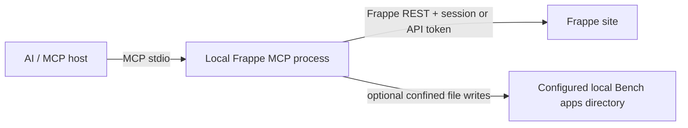

# Architecture

## Request flow

The MCP server runs as an independent Python process launched by the MCP host. It does not register a Frappe method, run inside a Bench worker, or require an app installation on the target site. The site is accessed through standard `/api/resource/...` and `/api/method/...` endpoints.

## Package layout

| Path | Responsibility |
|---|---|
| `frappe_mcp/standalone.py` | MCP stdio entry point, HTTP authentication, tools, bounded inputs, and optional local exports |
| `legacy/` | Previous Frappe app and transport source retained for reference; excluded from the installable package |
| `e2e/` | Standalone acceptance runners/evidence and the historical report from the old hosted implementation |
| `docs/` | User, agent, security, and compatibility documentation |

## Authentication and permissions

The process supports Frappe API token authentication or the standard login endpoint. Both auth modes require HTTPS for hosts other than loopback or `.localhost`, unless `FRAPPE_ALLOW_INSECURE_HTTP=YES` is set for a trusted development network. A password session is created only after a successful login; when it expires, `_request()` confirms the expiry with `frappe.auth.get_logged_user`, logs in again, and retries the request once. Credentials are read at process start and are never stored in the repository. Every API operation is made as that Frappe user, so native permissions and validation remain authoritative.

## Customization and exports

Create tools use standard REST resources such as `DocType`, `Custom Field`, and `Property Setter`. Standard DocType creation passes native field definitions, settings, and permissions through Frappe's DocType controller; in developer mode, Frappe performs schema setup and generates the JSON and controller scaffolds. Role permission changes use Frappe's System Manager-only Permission Manager methods. The user must have the corresponding Frappe permissions. Custom Fields and Property Setters need no local checkout; an optional `module` (and `app`) is checked only against the remote Module Def. The local export tools additionally require `FRAPPE_APPS_PATH` and verify that the requested Module Def belongs to the selected app on the remote site. Resolved module paths must remain below the configured directory.

Exports preview changes and return a `preview_id`. Confirmation must provide the current ID. Standard DocType JSON and fixtures are written to the selected module/app; a managed block in `hooks.py` registers fixture filters while preserving surrounding content. Existing files receive backups and an export manifest. `rollback_export` previews and restores/removes those files only if the exported contents have not changed since. Review exported code and use normal Git review and Bench migration/deployment procedures. The MCP does not run migrations or deploy changes.

## Limits

The generic server can discover and operate on custom app DocTypes through Frappe APIs, but it cannot transparently invoke every app-specific whitelisted method. A method needs an explicit tool wrapper and must be safe to expose. Arbitrary method dispatch, SQL, and Python execution are intentionally absent. See the roadmap and tool reference for supported operations.
