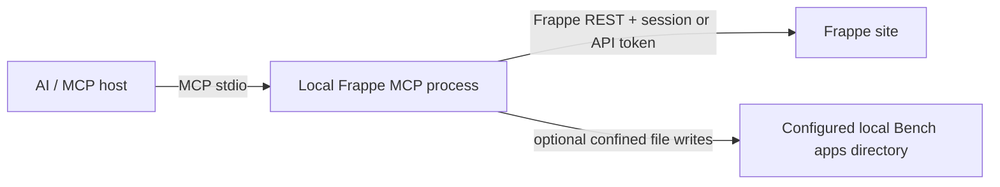

# Architecture

## Request flow

The MCP server runs as an independent Python process launched by the MCP host. It does not register a Frappe method, run inside a Bench worker, or require an app installation on the target site. The site is accessed through standard `/api/resource/...` and `/api/method/...` endpoints.

## Package layout

| Path | Responsibility |
|---|---|
| `frappe_mcp/standalone.py` | MCP stdio entry point, HTTP authentication, tools, bounded inputs, and optional local exports |
| `legacy/` | Previous Frappe app and transport source retained for reference; excluded from the installable package |
| `e2e/` | Standalone acceptance runners/evidence and the historical report from the old hosted implementation |
| `docs/` | User, agent, security, and compatibility documentation |

## Authentication and permissions

The process supports Frappe API token authentication or the standard login endpoint. Both auth modes require HTTPS for hosts other than loopback or `.localhost`, unless `FRAPPE_ALLOW_INSECURE_HTTP=YES` is set for a trusted development network. A password session is created only after a successful login; when it expires, `_request()` confirms the expiry with `frappe.auth.get_logged_user`, logs in again, and retries the request once. Credentials are read at process start and are never stored in the repository. Every API operation is made as that Frappe user, so native permissions and validation remain authoritative.

## Metadata

DocType metadata comes from `GET /api/method/frappe.desk.form.load.getdoctype`, the call Desk makes to open a form. Frappe answers with `frappe.get_meta` for the DocType and for each of its Table / Table MultiSelect DocTypes; `Meta` has already added Custom Fields, applied Property Setters, and sorted fields (`field_order`, then `insert_after`). `_meta_bundle()` turns that into `{"doctype": meta, "children": {name: meta}}`, drops the form assets (`__js`, print formats, templates), and caches it per process for `FRAPPE_META_TTL` seconds (default 300, `0` for no cache). The schema tools that change metadata drop the affected entries; record writes to schema DocTypes clear the whole cache.

`getdoctype` needs only a logged-in user, so field validation in the record tools no longer depends on reading the `DocType`, `Custom Field`, and `Property Setter` resources, which only System Manager can list. Record tools therefore work for any user with permission on the DocType, and Frappe still checks that permission on every record request. A filtered `list_documents` makes two requests with a cold cache (metadata, then the list) and one with a warm cache.

## Customization and exports

Create tools use standard REST resources such as `DocType`, `Custom Field`, and `Property Setter`. Standard DocType creation passes native field definitions, settings, and permissions through Frappe's DocType controller; in developer mode, Frappe performs schema setup and generates the JSON and controller scaffolds. Role permission changes use Frappe's System Manager-only Permission Manager methods. The user must have the corresponding Frappe permissions. Custom Fields and Property Setters need no local checkout; an optional `module` (and `app`) is checked only against the remote Module Def. The local export tools additionally require `FRAPPE_APPS_PATH` and verify that the requested Module Def belongs to the selected app on the remote site. Resolved module paths must remain below the configured directory.

Exports preview changes and return a `preview_id`. Confirmation must provide the current ID. `export_customizations` writes the same file as Frappe's own `frappe.modules.utils.export_customizations` (Customize Form's "Export Customizations"): `<app>/<app>/<module>/custom/<scrubbed doctype>.json`, holding `custom_fields`, `property_setters`, `custom_perms`, `links`, `doctype`, and `sync_on_migrate`, one file per DocType and per child-table DocType it uses. It builds the file from REST reads on the MCP side, so it needs no developer mode on the site and keeps the preview, backups, and rollback. `bench migrate` imports these files through `sync_customizations` when `sync_on_migrate` is set. Client Scripts are not part of that file; they go to the app-level `<app>/<app>/fixtures/client_script.json`, which `bench migrate` imports through `import_fixtures`, and a managed block in `hooks.py` registers the matching fixture filter while preserving surrounding content. DocType JSON is never exported: in developer mode Frappe writes standard DocType files itself. Existing files receive backups and an export manifest. `rollback_export` previews and restores/removes those files only if the exported contents have not changed since. Review exported code and use normal Git review and Bench migration/deployment procedures. The MCP does not run migrations or deploy changes.

## Editing DocTypes and reload reconciliation

`update_doctype` reads the DocType record (`GET /api/resource/DocType/<name>`, which keeps each field row's `name`), applies the operation list to a copy, and sends one `PUT` with the full `fields` list, the changed settings, and the preview's `modified`. Frappe's `update_child_table` updates rows whose `name` it knows, inserts rows without one, and deletes rows left out, so untouched fields keep their identity. Before saving, the tool checks Link and Table targets against the site's DocType list, counts affected records with `frappe.client.get_count`, and reads the DocType's meta to keep new fieldnames clear of Custom Fields.

Saving a standard DocType in developer mode makes Frappe's `on_update` export the JSON (`export_to_files`) and possibly rewrite the controller's type annotations. A Bench running with the reloader may restart the web worker and cut the response off. On `httpx.TransportError` the tool calls `_wait_for_server_ready`, re-reads the DocType, and reports success only if `modified` moved and the saved field order, the properties the operations set, and the DocType settings match the plan. Otherwise it fails and asks for a fresh preview; it never resends the save. `delete_doctype` uses the same pattern with `_wait_for_document_deleted`, since deleting a standard DocType in developer mode removes its folder, Python files included.

## Limits

The generic server can discover and operate on custom app DocTypes through Frappe APIs, but it cannot transparently invoke every app-specific whitelisted method. A method needs an explicit tool wrapper and must be safe to expose. Arbitrary method dispatch, SQL, and Python execution are intentionally absent. See the roadmap and tool reference for supported operations.
